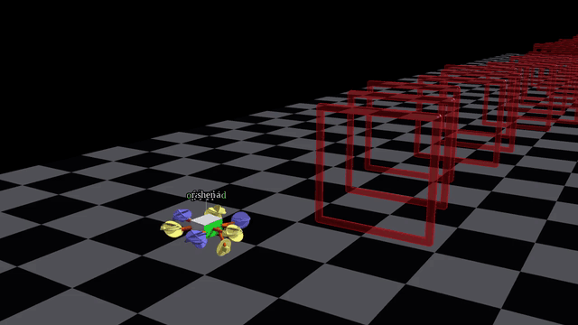

# Performance-guided Task-specific Optimization for Multirotor Design

Code for [Arza et al., *Performance-guided Task-specific Optimization for Multirotor Design*](https://arxiv.org/abs/2510.04724). This repository is a more efficient rewrite in [Newton](https://github.com/newton-physics/newton) of the methodology. Getting the result below (evaluating 800 designs + baselines) took 27 h on one RTX 5090 GPU.




## Setup

You need Linux and an NVIDIA GPU with driver ≥ 580 (the environment installs PyTorch built for CUDA 13.0). Install
[Miniconda](https://docs.anaconda.com/miniconda/) if you don't have conda:

```bash
wget https://repo.anaconda.com/miniconda/Miniconda3-latest-Linux-x86_64.sh
bash Miniconda3-latest-Linux-x86_64.sh -b -p ~/miniconda3
~/miniconda3/bin/conda init bash
source ~/.bashrc
```

Then,

```bash
git clone https://github.com/ntnu-arl/task-specific-multirotor-optimization.git
cd task-specific-multirotor-optimization
conda env create -f environment.yml
conda activate multirotor-opt
```

The first run compiles the Warp kernels, which takes a minute.

## Usage

Run all commands from the repository folder with the environment active (run `conda activate multirotor-opt` to activate the environment).

### Optimize a design

```bash
python evolve.py --run-dir results/myrun                                  # the paper's budget: 400 BO + 400 CMA-ES.
python evolve.py --run-dir results/test --bo-evals 40 --cma-evals 40     # a short test run that should finish in a few hours.
```

This optimizes for task B of the paper. For task A, set `TASK=A` on every command of the run (the default budget and seed are the same):

```bash
TASK=A python evolve.py --run-dir results/task_A
```

This should produce `results/<run>/` which contains:

| File | Contents |
|---|---|
| `progress.csv`, `evaluations.jsonl` | one line per evaluated design |
| `progress.pdf` | fitness over evaluations and time |
| `final_design.json` | the final design |
| `final_comparison.mp4`, `final_report.pdf`, `final_metrics.json` | video and report of the final design against the baselines |

A run interrupted after its BO goes on in its own folder (with the same `TASK`):

```bash
python evolve.py --run-dir results/myrun --resume
```


### Evaluate and render one design

```bash
python render_evaluation.py --design results/myrun/final_design.json --out results/myrun/render
python render_evaluation.py --design planar --out results/renders/planar   # or franchi, rajappa, shen
```

### Compare designs

```bash
python compare.py --out results/compare --seeds 8 --seed 1 \
    --designs planar franchi rajappa shen paper results/myrun/final_design.json
```

Trains every design 8 times from scratch (sequential halving each time) and evaluates each picked policy on 40960
episodes. `paper` is the optimized task B design reported on the paper obtained in the legacy codebase.

### Troubleshooting

Out of memory error.

With the current setup, `rl.py` trains 80 controllers at once (`TRAIN_CHUNK`), which needs about 14 GB of GPU memory. On a smaller GPU, set
it lower. It is slower, and the results could change with different parameters.

```bash
TRAIN_CHUNK=20 python evolve.py --run-dir results/myrun
```

## Citation

```bibtex
@misc{arza2025performance,
  title         = {Performance-guided Task-specific Optimization for Multirotor Design},
  author        = {Etor Arza and Welf Rehberg and Philipp Weiss and Mihir Kulkarni and Kostas Alexis},
  year          = {2025},
  eprint        = {2510.04724},
  archivePrefix = {arXiv},
  primaryClass  = {cs.RO},
  url           = {https://arxiv.org/abs/2510.04724}
}
```

